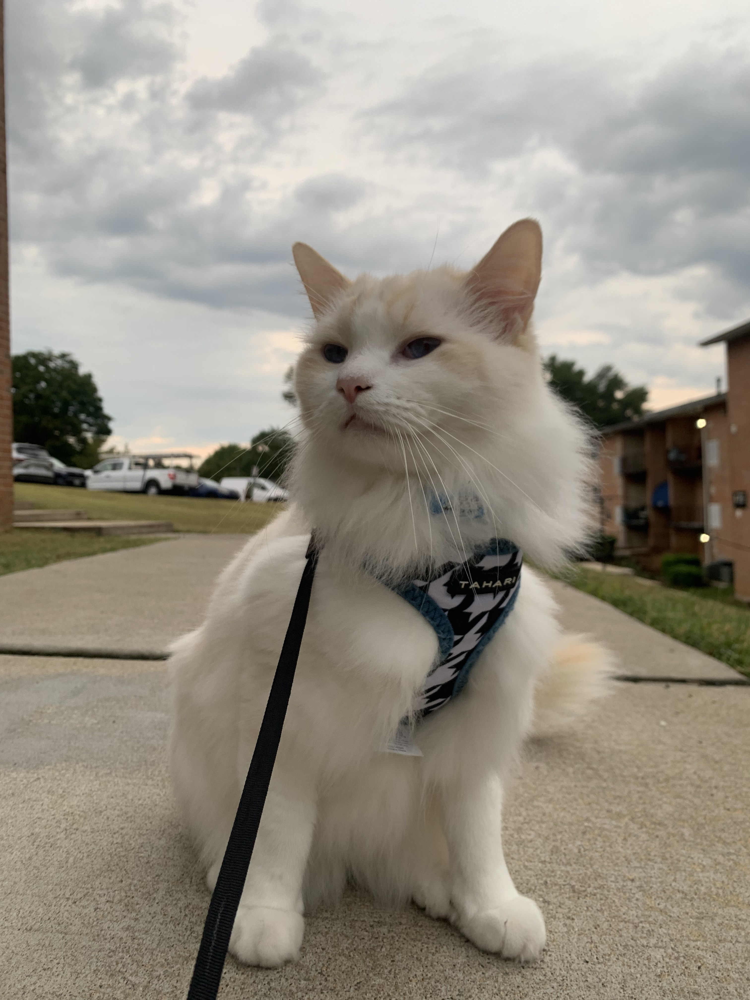

# Hi there, I'm Shu Wang! 👋

[✨ Check my Personal Website ✨](https://shu-su-wang.vercel.app/)

## About Me

- 🎓 M.S. Computer Science student at Georgia Tech, expected 2027.
- 💻 Software Developer Apprentice at Sony Interactive Entertainment · PlayStation, working on backend services and automated payment testing.
- 🌱 Techtonica 2026 cohort, with a background in bioinformatics and data analysis.
- 🛠️ Building with Java, Spring Boot, Python, JavaScript, TypeScript, and React.
- 🐱 Fun fact: My cat Bobo is my unofficial pair programmer—specializing in keyboard inspections and debugging supervision!
- ✍️ I share projects and lessons from learning and building on [my blog](https://shu-su-wang.vercel.app/blog).
- 📫 Contact me: [shuw425@gmail.com](mailto:shuw425@gmail.com) ｜ [LinkedIn](https://www.linkedin.com/in/shuuwang/)

